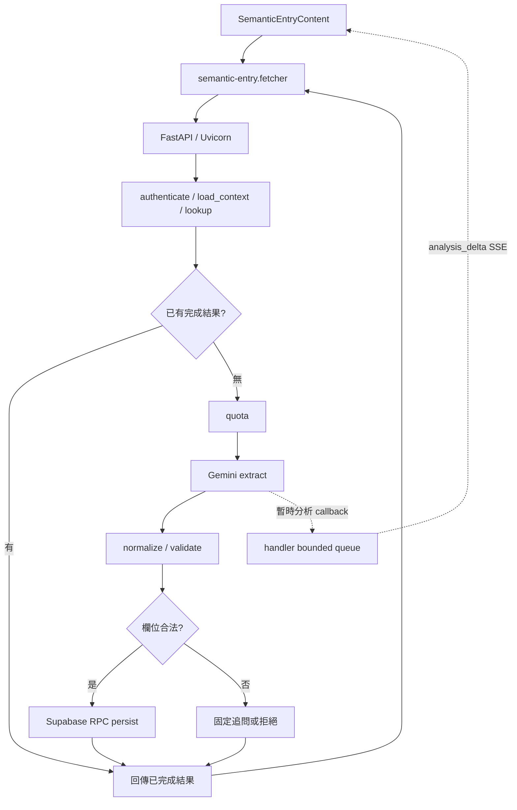

# 語意記帳串流分析與共用 AI 對話框：分支變更筆記

> 整理日期：2026-10-14。分支：`feat/semantic-entry-streaming-analysis`。
> 比較基準：`master`，共同基底 `d3c2d8f`；目前分支 HEAD：`2bd2f81`。
> 本文是方便回顧與交接的繁體中文筆記，不取代專案契約或原始驗證紀錄。依使用者要求保留為未提交檔案。

## 1. 這個分支解決什麼問題

原本的語意記帳會等待模型完成抽取，再顯示補充問題或儲存結果。使用者在等待期間無法看到模型已辨識到哪些資訊。文字記帳與圖片收據分析也有不同入口及對話框。

這個分支完成三組工作：

1. 將語意服務的 HTTP routing 遷移至 FastAPI，保留既有 wire validation、錯誤格式與 Uvicorn 啟動方式。
2. 在原有 Gemini 抽取流程加入簡短分析摘要，以 SSE 逐段傳送至前端，讓處理進度可見。
3. 將文字記帳與收據分析整合到同一個 AI dialog，再拆成上層容器與兩個獨立功能元件。

核心原則是：Gemini 提供「分析摘要＋欄位抽取」，程式判斷「資料是否合法、需要問什麼、能否寫入」。看到分析文字並不代表支出已儲存。

原有的語意記帳服務、Supabase RPC、額度及 request recovery 大部分已在基底存在；本分支是在這些流程上增加串流與整合 UI，並非重新建立整套記帳系統。

### 1.1 原版與修改版比較

此表以本分支共同基底 `master@d3c2d8f` 為原版，對照目前 `2bd2f81`。表中的「保留」表示沿用既有責任，不代表正式環境已重新驗證。

| 面向            | 原版                                                                                     | 修改版                                                                                         | 影響／維持的邊界                                                |
| --------------- | ---------------------------------------------------------------------------------------- | ---------------------------------------------------------------------------------------------- | --------------------------------------------------------------- |
| AI 功能入口     | 首頁「文字記帳」按鈕與每日卡片收據按鈕，各自開啟 dialog                                  | 每日卡片「AI 記帳」按鈕開啟共用 dialog，頂部切換文字／圖片，預設文字                           | 移除獨立文字入口，兩個功能集中使用                              |
| Dialog 與元件   | `SemanticEntryDialog` 管理文字 dialog；`AIReceiptImportDialog` 管理收據 dialog 與 wizard | `AIEntryDialog` 管理共用 shell；兩個 Content 元件各自管理功能                                  | 上層負責模式與共享 lock，功能狀態留在對應元件                   |
| 切換與進度      | 兩個獨立 dialog，沒有共用模式切換                                                        | 同一 dialog 的兩個 panel 保持 mounted，切換保留對話／圖片進度                                  | 每次重新開啟仍預設文字；關閉捨棄進度                            |
| HTTP framework  | Starlette application routing                                                            | FastAPI explicit routes、fallback 與 lifespan                                                  | Portable validation、CORS、JSON errors、Uvicorn entrypoint 保留 |
| Gemini 取回方式 | HTTPX 非串流 `generateContent`，等待完整抽取                                             | V2 路徑使用 `streamGenerateContent`，增量讀取摘要；非串流介面保留                              | 不增加另一個摘要模型呼叫                                        |
| Provider 回應   | Extraction 物件                                                                          | 嚴格的 `analysis`＋`extraction` envelope，再映射 extraction 回既有 raw 格式                    | 完整驗證後才採用欄位；拒絕額外 decision／question               |
| 使用者等待畫面  | 一般處理中、寫入中及最終問題／結果                                                       | 分析摘要先逐段出現，再顯示寫入狀態、固定問題或結果                                             | 暫時分析不等於已儲存，也不取代後續結果                          |
| SSE 事件        | `persisting`、`result`、`error`                                                          | 選擇 v2 時增加 `analysis_delta`；舊事件及 JSON response 保留                                   | 新舊前後端透過版本協商相容                                      |
| 串流驗證        | 原有 requestId／事件驗證                                                                 | 增加 analysis 序號、總字數、順序、唯一終止事件與 EOF 檢查                                      | 異常串流不能誤判成功，維持不確定結果恢復                        |
| LangGraph       | Auth/context/replay/quota/extract/validate/persist 節點與 `ainvoke`                      | 同一套 graph，增加 optional analysis callback 接力                                             | 不改為模型自主決策或另一套 graph streaming 架構                 |
| 誰判斷與追問    | Normalizer 檢查欄位，程式選固定問題，最多三輪補充                                        | 保留原有規則，摘要不參與決策                                                                   | 文字合法時仍自動寫入，沒有新增 draft approval                   |
| 收據保存        | 圖片分析後由使用者編輯並確認匯入                                                         | 同一流程移入 `ReceiptImportContent`                                                            | 仍須明確確認；外部 receipt service 契約保留                     |
| 關閉與 busy     | 文字提交期間鎖定；收據進入後續步驟有取消確認                                             | 共用 lock 包含兩個功能的 active request，並保留收據取消確認                                    | 操作期間不能切換／關閉；不確定 UUID recovery 保留               |
| 資料與儲存      | Supabase 持久化；既有 request/hash/quota、store/cache 與 UUID recovery                   | 相同資料契約與恢復方式，新增摘要僅在記憶體                                                     | 本分支不改 SQL，也不保存分析或長期對話                          |
| 模型次數與限制  | 每輪一次，最多三輪補充；800 generation output tokens、15 秒模型時限                      | 呼叫次數及限制保留，analysis 與 extraction 共用 output budget                                  | 可能增加平均 token／截斷風險，需實測                            |
| 成本            | 原有 extraction 模型費與服務成本                                                         | 增加 prompt/schema／摘要 token 與串流處理成本；UI 切換不增加呼叫                               | 增額與總成本分開估算，不能把每個 SSE chunk 算成一次模型呼叫     |
| 測試範圍        | 已有語意記帳、契約、恢復及前端流程測試                                                   | 增加 envelope/parser、真實 localhost 串流、backpressure、v2 parity、摘要生命週期及模式切換回歸 | Mock／fixture／localhost 通過不代表 hosted 或正式 DB 通過       |

## 2. 我們採用的規劃

### 2.1 串流分析的核准設計

既有 LangGraph 節點與決策維持。每輪只呼叫一次 Gemini，同一次回應包含：

- `analysis`：給使用者看的繁體中文短摘要，prompt 目標 40–80 字，驗證上限 200 Unicode code points。
- `extraction`：既有支出欄位，完整回應通過嚴格驗證後，交由 normalizer 處理。

不新增模型的 `decision` 或 `question` 欄位。若資料不完整，仍由既有 `clarification_result` 選擇固定問題；合法時自動儲存，不增加文字記帳的草稿核准步驟。

摘要可說明已辨識的內容與不確定之處，但不能用來繞過驗證。例如摘要寫「資訊完整」，而 `amount=null`，程式仍須追問金額。

完整規劃來源：[串流設計](../superpowers/specs/2026-10-14-gemini-streaming-conversation-design.md)與[實作計畫](../superpowers/plans/2026-10-14-gemini-streaming-analysis.md)。這兩份歷史文件中的 `SemanticEntryDialog.svelte`，在最後的 UI 重構已改為 `SemanticEntryContent.svelte`。

### 2.2 實作拆分

| 階段         | 計畫內容                                                       | 最終成果                                                                     |
| ------------ | -------------------------------------------------------------- | ---------------------------------------------------------------------------- |
| HTTP routing | 使用 FastAPI，但直接讀取 Request，避免自動 validation 改變契約 | 明確 health、POST、GET 路由與 fallback；停用自動 API 文件                    |
| Task 1       | 定義 analysis＋extraction envelope                             | Prompt、schema、嚴格 JSON decoder 與 envelope tests                          |
| Task 2       | 串流讀取 Gemini，增量解析 analysis 字串                        | HTTPX streaming、SSE decoder、部分 JSON 字串 parser                          |
| Task 3       | 接上 graph callback、版本協商與 HTTP transport tests           | `analysis_delta`、bounded queue、斷線／timeout／backpressure 處理            |
| Task 4       | Fetcher 驗證事件，UI 逐段呈現摘要                              | 純文字顯示、事件順序檢查、每輪與生命週期清理                                 |
| Task 5       | 整合驗證與交接                                                 | Backend checks、parity、fixture、container smoke、root/subpath E2E、驗證文件 |
| UI 整合      | 將文字入口移到收據 dialog，以頂部切換選擇功能                  | 移除首頁獨立文字按鈕；每日卡片的 AI 按鈕開啟共用 dialog                      |
| 元件重構     | 由較高層 dialog 容納兩個對應功能元件                           | `AIEntryDialog`、`SemanticEntryContent`、`ReceiptImportContent`              |

### 2.3 UI 整合時確認的行為

- 每次開啟預設顯示「文字記帳」。
- 頂部可切換「文字記帳／圖片分析」。
- 開啟期間切換功能保留對話內容、選取圖片及收據流程進度。
- 轉檔、上傳、分析、查詢或儲存等 active request 期間禁止切換及關閉。
- 文字記帳資訊完整後自動寫入；圖片分析仍須讓使用者檢查並明確確認匯入。
- 關閉後捨棄對話與收據進度。收據進入上傳後的步驟時，關閉需確認取消。
- 不確定的語意請求僅保存 UUID，重新開啟可查詢結果。

## 3. 最終元件與檔案結構

```text
src/routes/+page.svelte
└── AIEntryDialog.svelte
    ├── semantic-entry/SemanticEntryContent.svelte
    │   └── data/semantic-entry.fetcher.ts
    └── ai-receipt/ReceiptImportContent.svelte
        ├── StepHeader.svelte
        ├── UploadStep.svelte
        ├── AnalysisStep.svelte
        └── ConfirmStep.svelte
```

| 元件                   | 責任                                                                         | 與上層溝通                                                        |
| ---------------------- | ---------------------------------------------------------------------------- | ----------------------------------------------------------------- |
| `AIEntryDialog`        | Dialog shell、預設模式、切換按鈕、accessible title、合併 busy lock、協調關閉 | `open` 雙向綁定；轉交 `onImport`                                  |
| `SemanticEntryContent` | 輸入、補充歷史、摘要、送出、結果、retry/status recovery、store/cache 更新    | 綁定 `busy`；`requestClose()`；`onClose`                          |
| `ReceiptImportContent` | 收據步驟、圖片與 blob URL、分析結果轉預覽資料、匯入及取消確認                | 綁定 `busy`；接收 `open`；`requestClose()`；`onImport`／`onClose` |
| `ConfirmStep`          | 可編輯的收據項目、驗證與 bulk upsert                                         | `isSubmitting` 綁定，讓上層在保存時鎖定                           |

兩個功能元件在 dialog 開啟期間都保持 mounted，以 `hidden` 切換可見區域。切換本身不重新建立功能元件，避免遺失對話或圖片。

上層不再擁有收據的 `aiStep`、選取圖片及分析結果。收據功能自行判斷是否需要取消確認；上層依兩個功能回報的 busy state 決定是否允許切換與關閉。

Accessible title 由共用 dialog 唯一管理，隨模式更新，避免隱藏的圖片 panel 覆蓋文字模式的 dialog 名稱。分析區不逐字使用 `aria-live`；處理狀態保留原有通知。

### 3.1 舊元件的去向

- `AIReceiptImportDialog.svelte` 的收據協調工作移至 `ai-receipt/ReceiptImportContent.svelte`。
- `semantic-entry/SemanticEntryDialog.svelte` 移為 `SemanticEntryContent.svelte`，保留語意流程，移除獨立 dialog shell。
- 首頁只 render `AIEntryDialog`；每日卡片的 sparkle 按鈕加上「AI 記帳」accessible label。

## 4. 後端結構與資料流



| 檔案                               | 分工                                                                     |
| ---------------------------------- | ------------------------------------------------------------------------ |
| `server.py`                        | FastAPI routes、lifespan 共用 HTTPX client、環境依賴、Uvicorn entrypoint |
| `prompt.py`                        | Extraction schema、兩欄 envelope schema、繁體中文 prompt、prompt version |
| `provider.py`                      | 模型 request 設定、非串流／串流呼叫、完整回應與 usage 驗證               |
| `provider_stream.py`               | 增量 UTF-8／SSE 解碼與頂層 analysis JSON 字串解析                        |
| `graph.py`                         | Auth、可信 context、replay、quota、extract、validate、persist 編排       |
| `handler.py`                       | HTTP／SSE 回應、版本協商、queue、deadline、取消與不確定結果              |
| `normalize.py`／`clarification.py` | 原有欄位規則、轉換、固定問題及補充上限；摘要不改變其決策                 |
| `packages/semantic-entry-contract` | Browser request/response/event 驗證與 Python/browser parity              |

後端檔案位於 [semantic_entry](../../services/semantic-entry/semantic_entry/)。目前預設模型為 `gemini-3.5-flash-lite`，prompt version 為 `semantic-entry-v4-streaming-analysis`。

### 4.1 FastAPI 遷移的邊界

註冊 `GET /health`、`POST /semantic-entry`、`GET /semantic-entry/{requestId}`，再由 fallback 處理其他路徑／方法及既有 CORS／JSON errors。

Request body 仍由 portable validators 檢查，不改用 FastAPI 自動 body model。OpenAPI、Swagger UI 與 ReDoc endpoints 停用；Supabase JWT、caller-scoped 存取與既有授權流程保留。

## 5. 串流合約與限制

新前端透過 `Accept: text/event-stream; semantic-version=2` 選擇新版事件。

```text
analysis_delta（零到多個）
→ persisting（需要寫入時）
→ result 或 error（唯一終止事件）
→ EOF
```

問題、拒絕與 replay 可以直接回傳結果，不一定有 `persisting` 或分析事件。沒有 analysis 的舊後端仍可完成新前端的請求；舊前端未選 v2，則只收到既有事件。

`analysis_delta` payload 是 `{requestId, seq, text}`，`seq` 從 0 連續增加。前端檢查 UUID、序號、總字數及事件順序；寫入後的分析、第二個終止結果、缺少終止結果等情況不得誤判成功。

| 限制                         | 目前實作                                           |
| ---------------------------- | -------------------------------------------------- |
| 模型呼叫                     | 每輪最多一次；不新增自動模型 retry                 |
| 補充回答                     | 最多三輪；加上初次最多四次解析                     |
| 分析摘要                     | 1–200 Unicode code points；prompt 目標 40–80 字    |
| Generation output 設定       | `maxOutputTokens=800`，analysis 與 extraction 共用 |
| 模型 deadline                | 15 秒，適用整個呼叫，不因 chunk 重設               |
| Service deadline             | 30 秒                                              |
| Browser transport timeout    | 32 秒                                              |
| Provider SSE frame／累積文字 | 各 64 KiB                                          |
| Browser SSE 接收總量         | 64 KiB                                             |
| Handler queue                | 最多 64 個事件                                     |

### 5.1 Parser 與寫入安全

Parser 處理跨網路 chunk 的繁體中文、emoji、JSON escape、surrogate pair、CRLF 及多行 SSE，只增量輸出已解碼的頂層 `analysis`。

完整 structured envelope 必須通過嚴格 JSON/schema、完成原因及拒絕／截斷檢查，才將 extraction 交給 normalizer。原始 JSON、provider thought parts、完整 context 與 graph state 不轉送瀏覽器。若 metadata 缺少有效 token usage，保持 `null`，不自行補成零。

## 6. 關閉、斷線與結果恢復

持久化之前斷線，取消模型／graph 工作並關閉上游 stream。一旦持久化開始，不因回應中斷主動取消已接受的寫入；但 task 仍受 deadline 與容器生命週期限制，不能當作可靠的持久背景工作。

UI 送出前，以 account-scoped localStorage 保存 `{requestId}`。文字、答案、JWT 與分析不放入該記錄。

- 同一次不確定重試，凍結原有 text／history／UUID，不能用修改後的 payload 冒充相同請求。
- 關閉、reload 或 navigation 後，原 payload 不保留；只剩 status lookup。
- `not_found` 或重試失敗，不足以證明先前沒有寫入，不能清除原有 uncertainty。
- Account/revision guard 防止舊請求更新另一個帳號或新的操作。
- 新建結果走既有 store/cache 更新；replay/status recovery 重新取得相關月份，避免把舊 snapshot 當成目前資料。

整體 review 修正了兩個重要邊界：滿 queue 的 `persisting` 尚未入列時，不能提前標記已開始寫入；第一個 result 後仍須檢查剩餘事件及 EOF。相關回歸測試已加入。

分析只留在當次 UI 記憶體，每輪、新操作、關閉、帳號切換、page lifecycle 或 status query 時清除，不加入 history、localStorage、IndexedDB、資料庫或 raw tracing。

## 7. 成本估算

### 7.1 單價與計算範圍

2026-10-14 查閱官方頁面，`gemini-3.5-flash-lite` Standard 付費價格：input 每百萬 tokens US$0.30；output 每百萬 tokens US$2.50，output 包含 thinking tokens。來源：[Gemini 官方定價](https://ai.google.dev/gemini-api/docs/pricing#gemini-3.5-flash-lite)。

以下採這組付費單價，不計 cache、免費額度、稅金或匯率。實際帳戶 tier、模型設定與 token usage 尚未核對；這些是情境估算，並非帳單。中文字符數不能直接當成 token 數。

```text
每輪模型費用（USD）
= (input tokens × 0.30 + output tokens × 2.50) / 1,000,000

每筆支出模型費用
= 初次解析與各次補充的實際模型費用總和
```

Provider 的 `outputTokens` 會合併有效的 candidate 與 thought token 計數；不展示內部思考不代表這些 tokens 沒有費用。串流 chunks 不各自算一次新的模型呼叫。

### 7.2 原規劃：串流摘要帶來的增額

原規劃的示例是假設每輪因 prompt/schema／摘要增加 500 input tokens、200 output tokens：

```text
(500 × 0.30 + 200 × 2.50) / 1,000,000
= US$0.00065 / 輪
```

| 解析輪數 | 假設額外費用 |
| -------: | -----------: |
|      100 |     US$0.065 |
|    1,000 |      US$0.65 |
|   10,000 |      US$6.50 |

這是「相對舊流程的增額」，不是每筆記帳總成本。若一筆剛好使用四輪，按相同假設的增額是 US$0.0026。實際增加量須由新舊 prompt 的 token usage 比較取得。

### 7.3 總模型成本的假設情境

下表補充完整單輪成本，方便估量級；token 假設未經 live evaluation 測量。Output 假設視為可計費總 output，不能據此推論 generation cap 保證的最高帳單。

| 每輪假設用量            |   每輪成本 |   100 輪 | 1,000 輪 | 10,000 輪 |
| ----------------------- | ---------: | -------: | -------: | --------: |
| 1,500 input／400 output | US$0.00145 | US$0.145 |  US$1.45 |  US$14.50 |
| 3,000 input／800 output | US$0.00290 | US$0.290 |  US$2.90 |  US$29.00 |

以第一種情境估算，平均兩輪完成、每月 1,000 筆支出，模型費約 `1,000 × 2 × 0.00145 = US$2.90`。實際每輪會帶入可信 context 和已累積的 history，並不保證每輪 token 相同。拒絕、補充或 provider failure 也可能已產生用量；完成請求的 replay 在模型之前返回。

維持 800 generation output token 設定，不能保證平均費用不增加，也不能單靠它推算總費用上限。Prompt/context/history 的 input 長度、thinking usage 與補充輪數仍需觀察。

### 7.4 Cloud Run、資料庫與圖片功能

Checked-in 部署 workflow 設定 `min-instances=0`、`max-instances=2`、1 vCPU、512 MiB、CPU throttling。這是 repository configuration，不是已確認的 live service configuration。

串流沿用同一個 HTTP request。較長生成時間、較慢客戶端與 backpressure 可能增加 instance active time；同一 instance 可同時服務多個 request，不能把每個 request 的等待秒數直接相加當帳單。實際費用依 region、billing mode、用量與免費額度計算。來源：[Cloud Run 官方定價](https://cloud.google.com/run/pricing)。

本分支沒有增加 Redis、持久 queue、LangSmith hosted service、checkpointer 或分析儲存表。LangGraph 是服務內的 library。共用 dialog／模式切換本身不呼叫模型，也不新增第三個後端服務。

圖片分析仍使用既有外部 receipt service；其 backend 與價格不在本 repository。上面的 Gemini 計算僅適用語意服務，不能拿來估算收據圖片分析費用。Artifact Registry、Secret Manager、網路與其他雲端費用也未納入上述模型表。

### 7.5 如何取得實際估算依據

先取得另外授權，再以合成輸入進行 live evaluation，記錄 model、promptVersion、input/output tokens、補充輪數、首段延遲、總時間與截斷率。

既有 evaluator 可接收 `SEMANTIC_INPUT_USD_PER_MILLION`、`SEMANTIC_OUTPUT_USD_PER_MILLION`、`SEMANTIC_PRICING_SOURCE`、`SEMANTIC_PRICING_AS_OF`。Usage 或單價未知時，estimated cost 維持 `null`；fixture mode 沒有真實模型 token 或費用。

如果 800-token 設定下 analysis＋extraction 經常截斷，先縮短摘要／格式；調高 cap 或更改 thinking 設定前需重新評估。串流改善第一次可見回應的等待，並不保證總時間或帳單降低。

## 8. 變更提交對照

以下是分支相對目前 `master` 的提交，由早到晚排列：

| Commit    | 內容                                          |
| --------- | --------------------------------------------- |
| `0a29de5` | 語意服務 routing 遷移至 FastAPI               |
| `81594d0` | 記錄 Gemini 串流對話設計                      |
| `1180b15` | 明確保留程式規則式決策                        |
| `afe477c` | Provider 新增 bounded analysis envelope       |
| `05f089b` | Gemini 分析串流與增量解析                     |
| `d61862f` | Versioned analysis events、graph/handler 接力 |
| `ee152ac` | 限制 backpressure 下的 cleanup 行為           |
| `bf1b6e3` | 前端顯示串流分析與生命週期處理                |
| `c2f6a5d` | 串流驗證與交接文件                            |
| `2bd2f81` | 共用 AI dialog 與兩個功能元件整合             |

主要文件：[Architecture](../architecture.md)、[Database/service contracts](../database.md#semantic-entry-service)、[Deployment](../semantic-entry-deployment.md)、[README](../../README.md#semantic-expense-entry)。

## 9. 驗證結果與證據範圍

本節彙整已完成的驗證；此次寫筆記沒有重新執行 application build、backend 或 E2E。文件的檢查會另行執行。

### 9.1 Repository-verified：串流階段的歷史紀錄

來源：[2026-10-14 串流驗證紀錄](../evidence/semantic-entry/2026-10-14-streaming-analysis.md)。

| 檢查                          | 當時結果與範圍                                                                           |
| ----------------------------- | ---------------------------------------------------------------------------------------- |
| Backend pytest                | 187 passed；含 parser、graph、real localhost Uvicorn/HTTPX 分段傳輸與斷線測試            |
| Ruff check／format、mypy      | 通過                                                                                     |
| Fixture evaluation            | 40 case IDs、120 observations、0 failures、0 paid calls；只驗證 authored fixtures 與規則 |
| Python/browser parity         | 16 request cases、5 HTTP responses、6 SSE events 及錯誤格式 assertions                   |
| Docker build／container smoke | 通過，含 synthetic POST／GET／v1／v2 SSE；不代表 live DB／Gemini 成功                    |
| Semantic Playwright           | Root 38 passed；`/expense-app` subpath 38 passed                                         |
| Frontend check                | 0 errors、6 個既有 warnings                                                              |

### 9.2 Repository-verified：本次共用 dialog／元件重構

| 實際檢查                                                                                                           | 結果                                                                                                          |
| ------------------------------------------------------------------------------------------------------------------ | ------------------------------------------------------------------------------------------------------------- |
| 初版整合：`npm test`，使用 synthetic semantic endpoint                                                             | 全 frontend suite 43 passed                                                                                   |
| 最終元件拆分：`npm run test:e2e -- e2e/semantic-entry.test.ts e2e/daily-carousel.test.ts`，使用 synthetic endpoint | 42 passed；包含 default mode、switching、保留文字／圖片、reset、busy lock、clarification/recovery 與 carousel |
| `npm run check`                                                                                                    | 0 errors、6 個既有 warnings                                                                                   |
| 變更檔案 Prettier／ESLint、`git diff --check`                                                                      | 通過；兩次獨立 review 未發現剩餘 blocking issue                                                               |
| `npm run lint`                                                                                                     | 失敗：122 個既有檔案有 Prettier 格式問題，因 `&&` 未進入 whole-repository ESLint                              |

43 與 42 的差異是最終拆分僅跑 semantic＋carousel specs，沒有再跑 scaffold/demo spec，不是刪除測試。Subpath 的 38-test 證據來自較早串流階段；最終共用 dialog 重構沒有重跑 subpath suite。

本次 browser tests 使用 mocked Supabase／semantic service 及 synthetic session，不會執行付費 Gemini 或真實收據分析。Changed-file lint 通過不能代替 whole-repository lint。

### 9.3 Operator-reported 與 unverified

沒有提供這次分支更新後的 operator-reported hosted acceptance 或帳單結果。

尚未驗證：指定 live Gemini key／模型是否接受新 schema、800-token 設定下的完成率、實際成本、Cloud Run buffering／instance termination，以及正式 Supabase 交易、GoTrue、RLS 與 receipt service 行為。先前資料庫 evidence 有其環境及日期範圍，不能由本分支 mocks 擴張成新的正式環境保證。

## 10. 範圍、風險與下一步

本分支沒有修改 SQL schema、額度或 request hash 演算法；沒有增加保存分析或長期對話的功能。語意記帳仍只處理既有支援範圍：單筆已發生的正整數 TWD 支出、既有個人／家庭規則及成員均分。寫入後用 AI 修改／刪除、批次語意支出、自主工具呼叫及排程解析不在這次範圍。

剩餘需要觀察的是摘要與抽取是否一致、分析占用 output budget 是否造成截斷、首段延遲是否在 hosted 環境改善，以及較慢客戶端的端到端傳輸行為。

建議後續順序：

1. PR review／CI 確認此分支的 code、contract 與 UI 整合。
2. 在另行授權的 hosted acceptance 使用合成輸入，量測模型 schema、摘要、實際 tokens、首段延遲與結果恢復。
3. 更新實測成本與品質紀錄，決定是否需要調整摘要或 token 設定。
4. 由 operator 執行授權的 backend／frontend release；目前 Cloud Run workflow 僅從 `master` 手動觸發。

本筆記不授權部署、正式資料庫變更或付費模型呼叫；也不表示這些動作已由測試完成。
